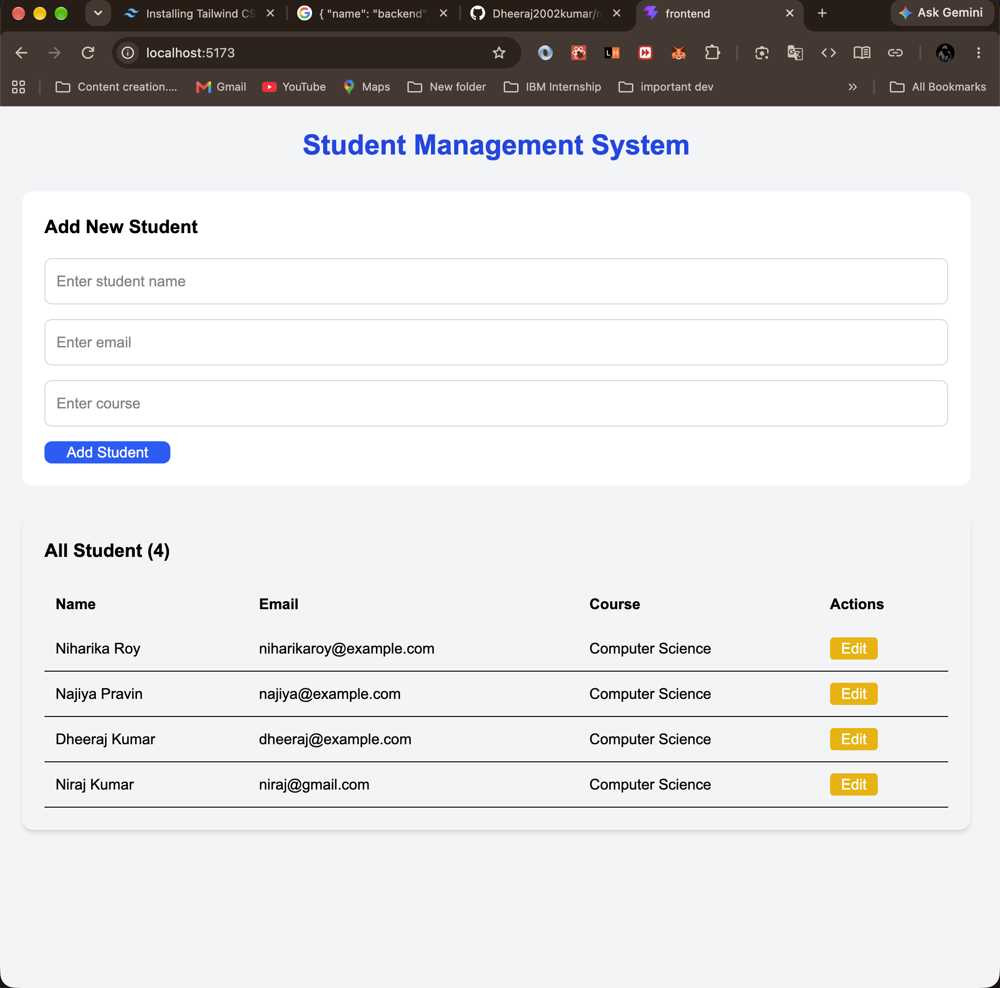

# MERN Student API

A simple MERN-style student management application.

## Screenshot



## Frontend

In a separate terminal, install dependencies and start the Vite development server:

```bash
cd frontend
npm install
npm run dev
```

Open the URL printed in the terminal (usually `http://localhost:5173`). Make sure the backend is running as well.

## Backend

The backend is an Express.js API that stores student records in MongoDB.

### Setup

```bash
cd backend
npm install
```

Create `backend/.env`:

```env
PORT=5000
MONGO_URI=your_mongodb_connection_string
```

Start the server:

```bash
npm start
```

The API is available at `http://localhost:5000/api/students`.

### API Routes

| Method | Route | Description |
| --- | --- | --- |
| GET | `/api/students` | Get all students |
| GET | `/api/students/:id` | Get one student |
| POST | `/api/students` | Create a student |
| PUT | `/api/students/:id` | Update a student |
| DELETE | `/api/students/:id` | Delete a student |
